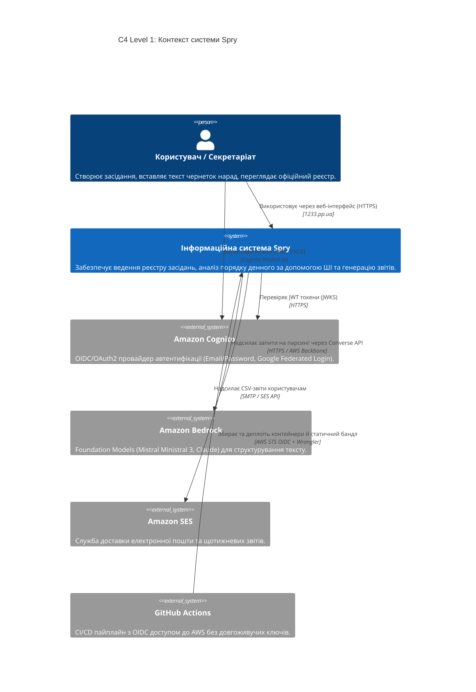
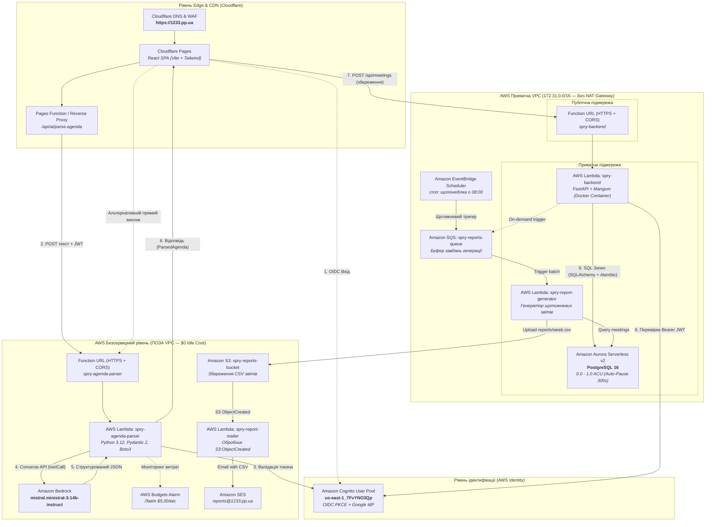
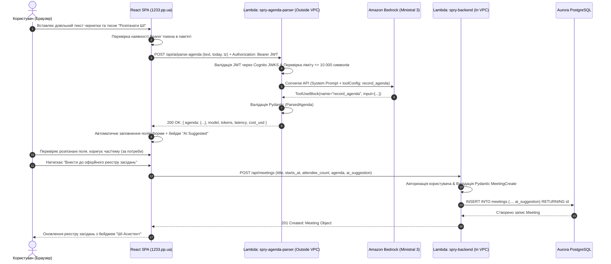

# Архітектура системи Spry (Spry Cloud Architecture)

Цей документ описує **актуальний цільовий стан архітектури** системи обліку засідань та нарад **Spry** (станом на 2026 рік, за підсумками реалізації Лабораторних робіт 1–6). 

Документ фіксує розподіл компонентів, мережеві межі (VPC), інтеграцію з моделлю штучного інтелекту Amazon Bedrock, подієво-орієнтовані процеси (Event-Driven Architecture), модель безпеки та оптимізацію витрат за принципом **Zero Idle Cost ($0 при простої)**.

---

## 1. Загальний огляд системи (Executive Summary)

Система **Spry** — це сучасний монорепозиторій для планування, обліку та аналізу пленарних засідань та робочих нарад Верховної Ради України / бізнес-організацій.

### Ключові архітектурні драйвери (Architectural Drivers)
1. **NFR-8 / Zero Idle Cost ($0/міс)**: Система для навчальних та пілотних проєктів не повинна генерувати постійних витрат на неробочі ресурси. Будь-які компоненти масштабуються до нуля при відсутності запитів.
2. **AI-Assisted Processing («Model suggests, human decides, core API writes»)**: Штучний інтелект (LLM) через Amazon Bedrock розпізнає неструктурований текст чернеток або чатів, але ніколи не має прямого доступу до бази даних і не здійснює мутацій без підтвердження користувача.
3. **Event-Driven Resilience**: Важкі регулярні задачі (щотижневі звіти, відправка пошти) винесені в асинхронні черги (SQS) та тригери подій (EventBridge, S3 Events), не блокуючи синхронний HTTP-запит користувача.
4. **Сувора ізоляція мережі (VPC Boundary)**: База даних та ядро API надійно сховані всередині приватних підмереж, тоді як безсерверний ШІ-парсер винесено за межі VPC для уникнення платних NAT Gateway ($32/міс) та PrivateLink VPC Endpoints ($7.30/міс).

---

## 2. C4 Діаграма контексту системи (Level 1: System Context)

---

## 3. C4 Діаграма контейнерів системи (Level 2: Container Architecture)

Нижче наведено повну схему поточної топології компонентів з відображенням мережевих меж (Edge, Outside VPC, Inside VPC).

---

## 4. Каталог компонентів та технологічний стек

### 4.1. Фронтенд (Frontend Presentation Tier)
- **Розміщення**: **Cloudflare Pages** (проєкт `1233-ooad`), прив'язаний до кастомного домену `https://1233.pp.ua`.
- **Фреймворк**: React 18, Vite, TypeScript, Tailwind CSS, Lucide Icons.
- **Дизайн-система**: Стилістика офіційного порталу Верховної Ради України (кольори `#0e317e`, `#184dbd`, `#ffe358`, Державний Герб України, семантичні розділи статей реєстру, адаптивна підтримка світлої та темної тем).
- **Автентифікація**: Бібліотека `react-oidc-context` (OIDC Authorization Code Flow з PKCE).
- **Маршрутизація API**: Вбудовані Cloudflare Pages Functions (`/api/ai/parse-agenda`) для забезпечення same-origin proxy без конфліктів міждоменних запитів (CORS).

### 4.2. ШІ-сервіс розпізнавання порядку денного (AI Agenda Parser)
- **Функція**: `spry-agenda-parser` (AWS Lambda).
- **Мережеве розташування**: **Поза межами VPC (Outside VPC)**. Забезпечує $0 вартості простою та прямий швидкісний доступ до публічних ендпоінтів Amazon Bedrock.
- **Модель**: **`mistral.ministral-3-14b-instruct`** (Amazon Bedrock Converse API у регіоні `us-east-1`).
- **Схема виклику (Tool Calling)**: Інструмент `record_agenda` зі строгою типізацією Pydantic (`ParsedAgenda`, `AgendaItem`, `ActionItem`).
- **Відмовостійкість (Fallback)**: 1 автоматичний повтор при помилці валідації схеми з передачею тексту помилки назад у модель для самовиправлення.
- **Захист від витрат**: AWS Budgets Alarm на рівні **$5.00/місяць** із негайним надсиланням сповіщення адміністратору.

### 4.3. Ядро бекенда (Core API Backend)
- **Функція**: `spry-backend` (AWS Lambda).
- **Мережеве розташування**: **Всередині VPC (Inside VPC)** у приватних підмережах поруч із кластером бази даних.
- **Технологія**: Python 3.12, FastAPI, SQLAlchemy 2.0, адаптер Mangum, драйвер `psycopg` (v3).
- **Контейнеризація**: Образ на базі AWS Lambda Python Base Image, що зберігається в **Amazon ECR** (`spry-backend:latest`).
- **Міграції**: Автоматичні міграції Alembic, які запускаються програмно безпосереднім викликом Lambda з корисним навантаженням `{"action": "migrate"}`.

### 4.4. База даних (Database Tier)
- **Кластер**: **Amazon Aurora Serverless v2 PostgreSQL** (`spry-aurora`, версія 16.x).
- **Конфігурація масштабування**: `MinCapacity: 0.0 ACU`, `MaxCapacity: 1.0 ACU`, `SecondsUntilAutoPause: 300` (5 хвилин).
- **Поведінка**: При відсутності трафіку база переходить у стан паузи (0 ACU = $0 за обчислення). При надходженні першого запиту автоматично відновлює роботу за ~15 секунд (тайм-аут бекенд-лямбди встановлено у 60 секунд).
- **Схема даних**: Таблиця `meetings` з підтримкою `agenda` (текст порядку денного) та `ai_suggestion` (JSONB для збереження метаданих розпізнавання, використаних токенів, моделі та вартості).

### 4.5. Подієво-орієнтована звітність (Event-Driven Reporting)
- **EventBridge Scheduler**: Розклад `cron(0 8 ? * MON *)` надсилає подію на генерацію щотижневого звіту.
- **Amazon SQS**: Черга `spry-reports-queue` ізолює розклад від безпосереднього виконання завдання.
- **Worker 1 (`spry-report-generator`)**: Зчитує повідомлення з SQS, підключається до Aurora всередині VPC, формує CSV-звіт і зберігає його в S3.
- **Amazon S3**: Бакет `spry-reports-*` генерує подію `s3:ObjectCreated:*`.
- **Worker 2 (`spry-report-mailer`)**: Працює поза VPC, перехоплює подію S3, завантажує файл та відправляє email через **Amazon SES** із адреси `reports@1233.pp.ua`.

---

## 5. Детальні сценарії взаємодії (Interaction Workflows)

### 5.1. Сценарій: ШІ-розпізнавання та збереження порядку денного

---

## 6. Аналіз витрат та оптимізація (Cost Engineering & Zero-Idle Analysis)

Архітектура реалізує вимогу **NFR-8** (< $0.15 на активного користувача на місяць та $0 при простої).

| Компонент | Традиційний підхід (Always-On) | Наш безсерверний підхід (Spry) | Вартість при простої (Idle Cost) |
|---|---|---|---|
| **API Compute** | ECS Fargate 24/7 + ALB (~$35/міс) | **AWS Lambda + Function URL** | **$0.00** |
| **База даних** | RDS PostgreSQL db.t3.micro (~$18/міс) | **Aurora Serverless v2 (0–1 ACU Auto-Pause)** | **$0.00** за обчислення (тільки зберігання ~$0.10/GB) |
| **З'єднання з ШІ** | NAT Gateway у VPC ($32.40/міс) або PrivateLink ($7.30/міс) | **Парсер винесено за межі VPC (Outside VPC)** | **$0.00** |
| **ШІ-модель** | Виділені сервери / підписка ($20–$100/міс) | **Amazon Bedrock (On-Demand Pay-per-token)** | **$0.00** (~$0.00013 за 1 засідання) |
| **Фронтенд CDN** | CloudFront без лімітів або власний Nginx | **Cloudflare Pages (Free Tier, 0 egress fees)** | **$0.00** |
| **Разом при простої** | **~$85 – $120 / місяць** | **Безсерверна архітектура Spry** | **~$0.00 – $0.50 / місяць** |

---

## 7. Модель безпеки (Security & Guardrails)

1. **Принцип найменших привілеїв (Least Privilege IAM)**:
   - Роль `spry-agenda-parser-role` має права виключно на `bedrock:InvokeModel` та `bedrock:Converse`. Вона не має прав на VPC, EC2 чи базу даних.
   - Роль `spry-backend-role` має доступ до підмереж VPC та секретів бази даних, але позбавлена прав адміністрування інфраструктури.
2. **Захист від фінансового виснаження (Denial of Wallet / DoW)**:
   - Встановлено квоту довжини вхідного тексту: не більше 10 000 символів (відсікає HTTP 413 до виклику Bedrock).
   - Обов'язкова авторизація через JWT: неавторизовані запити не доходять до виклику LLM (HTTP 401).
   - Щомісячний бюджетний алярм AWS Budgets на **$5.00** блокує накопичення непередбачуваних витрат.
3. **Захист від Prompt Injection**:
   - Ін'єкція не може виконати довільний код чи SQL-ін'єкцію, оскільки парсер повертає лише строго валідований Pydantic-об'єкт.
   - Порожні або шкідливі поля відхиляються на рівні валідації схеми (`min_length=1`), а будь-яка зміна даних у системі вимагає ручного підтвердження людиною.

---

## 8. Інфраструктура як код (IaC) та CI/CD

Вся інфраструктура описана декларативно в директорії `infra/`:
- [`infra/main.tf`](file:///home/sasha/work_dir/1233_ooad/infra/main.tf): Опис VPC, підмереж, Security Groups, ECR, Lambda бекенда та Aurora Serverless v2.
- [`infra/auth.tf`](file:///home/sasha/work_dir/1233_ooad/infra/auth.tf): Опис Cognito User Pool, Client, домену та інтеграції з Google.
- [`infra/ai.tf`](file:///home/sasha/work_dir/1233_ooad/infra/ai.tf) / [`infra/ai.yml`](file:///home/sasha/work_dir/1233_ooad/infra/ai.yml): Опис лямбди `spry-agenda-parser` поза VPC, Function URL з CORS, дозволів Bedrock та AWS Budget.
- [`infra/reports.tf`](file:///home/sasha/work_dir/1233_ooad/infra/reports.tf): Опис EventBridge, SQS, S3 bucket та воркерів розсилки звітів через SES.
- [`.github/workflows/ci.yml`](file:///home/sasha/work_dir/1233_ooad/.github/workflows/ci.yml): Автоматизований пайплайн із перевіркою форматування (`ruff`, `prettier`), лінтування (`eslint`, `ruff check`), 52 тестів `pytest` та автоматичним деплоєм через GitHub OIDC (без збереження паролів AWS).
