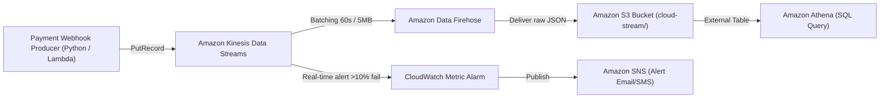

# Звіт з Лабораторної роботи №8: Data Pipelines (Batch & Streaming Analytics)

**Студент:** Олександр Оксентюк  
**Курс:** Object-Oriented Analysis & Design (OOAD)  
**AWS Account ID:** `791614297907` | **Регіон:** `us-east-1`  
**Датасет:** Жовтень 2026 (~3 030 197 подій платежів, 1 000 000 унікальних інвойсів)

---

## Частина 0 та 1 — Архітектура даних (Аналіз Uklon)

### 1. Що станеться, якщо шлях реального часу (real-time) відстане на 10 хвилин, а пакетний шлях (batch) — на 1 день?
- **Real-time затримка на 10 хвилин**: Це критична аварія для бізнесу поїздок:
  1. *Матчинг пасажир-водій зламається*: алгоритм пропонуватиме водіїв, які вже 10 хвилин тому поїхали з цієї точки.
  2. *Surge pricing (динамічні тарифи)*: Apache Flink рахуватиме коефіцієнт попиту за неактуальними даними, через що компанія зазнає прямих фінансових збитків або водії відмовлятимуться від замовлень через низький тариф під час затору чи дощу.
  3. Користувачі та водії бачитимуть застарілі позиції на карті, що призведе до скасувань поїздок.
- **Batch затримка на 1 день**: Для операційної роботи сервісу це не є катастрофою:
  1. Автомобілі продовжують успішно приймати виклики та возити пасажирів у реальному часі.
  2. Затримаються лише щоденні аналітичні звіти для продакт-менеджерів, виплати партнерам та плановий перерахунок моделей машинного навчання (ML) у SageMaker. Бізнес продовжує генерувати виручку.

### 2. Чому GPS не йде через AWS Lambda?
- **Обсяг трафіку**: При масштабі ~580 млн GPS-пінгів на добу (~6700 запитів щосекунди із піками понад 15–20 тис./сек) використання комбінації `API Gateway + Lambda` є економічно та архітектурно неефективним:
  1. *Вартість*: Тільки за виклики API Gateway ($3.50/млн) та обчислення Lambda довелося б сплачувати **понад $60 000 – $80 000 щомісяця**.
  2. *Мережевий оверхед*: Відкриття та узгодження нового HTTP(S) з'єднання кожні 3 секунди від сотень тисяч водіїв створює гігантський TLS handshake оверхед та розряджає батареї смартфонів.
  3. *Рішення Uklon*: Використання легковісного протоколу **MQTT через AWS IoT Core** з постійним відкритим сокетом. Це зменшує витрати в рази та забезпечує мінімальну затримку (sub-second latency) передачі координат прямо в Redis та Kinesis.

### 3. Від яких частин діаграми маленький стартап відмовився б у першу чергу, і що б він втратив?
1. **Відмовився б від**:
   - **Apache Flink (Managed Service for Apache Flink)**: дорогий в обслуговуванні та розгортанні кластерний фреймворк потокової обробки.
   - **SageMaker ML Pipelines**: складні автоматичні конвеєри навчання ETA замінюються простими статистичними коефіцієнтами або зовнішніми API карт (Google / OSRM).
   - **AWS IoT Core**: на старті замінюється пулом WebSocket-воркерів на ECS/EC2.
   - **Окремого Glue Data Lake**: замінюється прямими SQL-запитами чи копіюванням даних у PostgreSQL / ClickHouse.
2. **Що втрачає стартап**:
   - Втрачає здатність миттєво реагувати на сплески попиту в мікрорайонах (динамічний surge pricing стає спрощеним або загальноміським).
   - Знижується точність передбачення часу прибуття (ETA), що може збільшити час очікування пасажира.

---

## Частина 2 — Batch-аналітика в AWS: Платежі в S3

### Масштаб та характеристики даних (What to submit for Part 2)

| Показник | Значення | Коментар |
|---|---|---|
| **Загальна кількість подій (Total rows)** | **3 030 197** | Усі події у 31 партиції `dt=2026-10-01` .. `dt=2026-10-31` |
| **Унікальних платежів (`invoiceId`)** | **1 000 000** | Рівно 1 млн унікальних транзакцій за жовтень 2026 |
| **Точних дублікатів подій** | **30 197** (~1.00%) | Повністю ідентичні рядки, що надійшли повторно |
| **Подій із затримкою > 60 секунд** | **60 824** (2.01%) | Різниця `receivedAt` мінус `modifiedDate` > 60 сек |
| **Подій із затримкою > 1 години** | **0** (0.00%) | Жодна подія не запізнилася більше ніж на 600 секунд (макс. затримка — 10 хв) |

---

### Результати запитів Athena (Queries 2–6)

#### Query 2 — Дедуплікація (View `payments`)
Збережено рівно **1 000 000 рядків** (по одному останньому актуальному стану для кожного `invoiceId`):
```sql
CREATE OR REPLACE VIEW lab8_payments.payments AS
WITH deduplicated_events AS (
    SELECT DISTINCT * FROM lab8_payments.payment_events
),
ranked_payments AS (
    SELECT *,
        ROW_NUMBER() OVER (
            PARTITION BY invoiceId 
            ORDER BY from_iso8601_timestamp(modifiedDate) DESC, from_iso8601_timestamp(receivedAt) DESC
        ) AS rn
    FROM deduplicated_events
)
SELECT * FROM ranked_payments WHERE rn = 1;
```

#### Query 3 — Обіг (Turnover) за мерчантами та валютами (Топ-10)

| Мерчант (`merchantName`) | Валюта | Успішних транзакцій | Загальний обіг (основні одиниці) |
|---|---|---|---|
| **Інтернет-магазин** (`m-009`) | **UAH** | 87 115 | **310 259 259.21 ₴** |
| **АЗС** (`m-008`) | **UAH** | 87 560 | **144 641 341.06 ₴** |
| **Квитки** (`m-010`) | **UAH** | 87 303 | **77 749 863.65 ₴** |
| **Супермаркет** (`m-002`) | **UAH** | 87 283 | **54 147 597.02 ₴** |
| **Доставка їжі** (`m-004`) | **UAH** | 87 820 | **46 044 018.26 ₴** |
| **Аптека** (`m-007`) | **UAH** | 87 374 | **38 554 151.04 ₴** |
| **Таксі** (`m-003`) | **UAH** | 87 307 | **21 528 219.39 ₴** |
| **Інтернет-магазин** (`m-009`) | **USD** | 3 725 | **$13 840 942.83** |
| **Онлайн-кінотеатр** (`m-005`) | **UAH** | 87 357 | **13 016 193.00 ₴** |
| **Кав'ярня** (`m-001`) | **UAH** | 87 637 | **11 435 687.68 ₴** |

#### Query 4 — Відсоток відмов (Failure rate) за методами оплати та пристроями

| Платіжний метод | Пристрій | Всього платежів | Неуспішних | Частка відмов (% Failure) |
|---|---|---|---|---|
| **qr** | **android** | 6 675 | 448 | **6.71%** |
| **apple_pay** | **android** | 83 677 | 5 130 | **6.13%** |
| **google_pay** | **web** | 59 996 | 3 645 | **6.08%** |
| **card** | **android** | 183 332 | 11 079 | **6.04%** |
| **apple_pay** | **ios** | 83 164 | 5 025 | **6.04%** |
| **card** | **web** | 183 435 | 11 020 | **6.01%** |
| **google_pay** | **ios** | 59 761 | 3 590 | **6.01%** |
| **qr** | **web** | 6 669 | 400 | **6.00%** |
| **google_pay** | **android** | 59 450 | 3 563 | **5.99%** |
| **apple_pay** | **web** | 83 505 | 4 966 | **5.95%** |
| **card** | **ios** | 183 541 | 10 912 | **5.95%** |
| **qr** | **ios** | 6 795 | 402 | **5.92%** |

*Висновок*: Частка відмов є стабільною на рівні ~6.0%, з невеликим статистичним сплеском на QR-платежах на Android (6.71%).

#### Query 5 — Пікові години навантаження (Peak hours UTC)
- **Найнижче навантаження (ніч UTC)**: 00:00 – 04:00 (~6 500 платежів/год).
- **Денні піки**:
  - Обідній час: 12:00 – 13:00 (~66 300 платежів/год).
  - Вечірній пік активності: 17:00 – 19:00 (максимум о **18:00 UTC — 80 338 платежів/год**).

---

### Порівняння JSON vs Parquet: Економія та швидкість

| Запит | Проскановано JSON | Проскановано Parquet | Зменшення сканування | Час JSON | Час Parquet | Прискорення |
|---|---|---|---|---|---|---|
| **Query 3 (Turnover)** | 1 202.29 MB | **6.09 MB** | **у 197.3 разів дешевше** | 4.19s | **0.88s** | **у 4.7 разів швидше** |
| **Query 4 (Failure rate)** | 1 202.29 MB | **0.64 MB** | **у 1886.7 разів дешевше** | 3.83s | **1.19s** | **у 3.2 разів швидше** |
| **Query 5 (Peak hours)** | 1 202.29 MB | **6.37 MB** | **у 188.8 разів дешевше** | 53.88s | **1.12s** | **у 48.2 разів швидше** |

> **Чому це важливо для бізнесу?**  
> AWS Athena тарифікує запити за обсягом просканованих даних ($5 за кожні 1 ТБ). У JSON форматі кожен запит вимушений зчитувати всі 1.2 ГБ сирих текстових даних. У форматі Parquet завдяки колонковому зберіганню (columnar projection) та стисненню Snappy Athena читає лише необхідні стовпчики (наприклад, тільки `paymentMethod`, `device` та `status`). Це робить аналітику **до 1880 разів дешевшою** та зменшує тривалість запитів з хвилини до 1 секунди.

---

### Way B: Glue Crawler vs Ручна схема (Порівняння)

1. **Типи даних**:
   - `amount` та `finalAmount`: Crawler обрав `int`. У ручній схемі ми вказали `BIGINT`, що є значно надійнішим, оскільки в копійках великі транзакції можуть спричинити integer overflow.
   - `ccy`: Crawler коректно визначив як `int` (числовий код ISO 4217).
   - Дати (`createdDate`, `modifiedDate`, `receivedAt`): Crawler записав їх як `string`.
2. **Розпізнавання партицій**:
   - Glue Crawler автоматично розпізнав структуру каталогів `dt=YYYY-MM-DD/` як ключ партиціонування (`PartitionKey: dt`).
3. **Опціональне поле `failureReason`**:
   - Crawler успішно виявив це поле у схемі (`string`), незважаючи на те, що воно присутнє лише у подіях зі статусом `failure`.
4. **Що зручніше**:
   - Ручна схема дає повний контроль над типами (запобігає обрізанню чисел через `BIGINT`, налаштовує SerDe параметри `ignore.malformed.json`). Glue Crawler зручний для первинного швидкого виявлення невідомих схем у Data Lake, але у виробничому середовищі фінальні схеми завжди закріплюються у вигляді Infrastructure as Code (Terraform / DDL).

---

### Відповідь: Чому `DISTINCT` передує `ROW_NUMBER()`, і що ламається без дедуплікації?
1. **Чому спочатку DISTINCT**:
   - Оскільки близько 1% вебхуків надіслано повторно (мережеві ретраї платіжного шлюзу), у таблиці існують записи з абсолютно однаковими значеннями всіх полів (включаючи `invoiceId`, `status`, `modifiedDate` та `receivedAt`).
   - Якщо одразу застосувати віконну функцію `ROW_NUMBER() OVER (PARTITION BY invoiceId ORDER BY modifiedDate DESC, receivedAt DESC)` до рядків із однаковими мітками часу, сортування між дублікатами стане недетермінованим. 
   - Попередній `DISTINCT` гарантує очищення від надлишкового сміття перед сортуванням у пам'яті воркерів.
2. **Що ламається без дедуплікації**:
   - Якщо аналітик порахує `COUNT(*)` без дедуплікації за `invoiceId`, він отримає 3 мільйони записів замість 1 мільйона платежів.
   - Обіг (Turnover) буде завищено, оскільки проміжні події `created` та `processing` помилково додаватимуться до розрахунку або повторно враховуватимуться дублікати.
   - Failure rate стане хибним, оскільки кожен успішний платіж проходив стадію `created` і був би порахований декілька разів.

---

## Частина 3 — Локальний стрімінг (Redpanda + Python)

Пайплайн відтворює події у порядку `receivedAt` з ключем повідомлення `invoiceId`, спрямовуючи всі оновлення одного інвойсу в одну партицію.

### Результати 4 експериментів:

1. **Експеримент 1 (Зупинка консьюмера на 1 хвилину)**:
   - *Спостереження*: Після зупинки консьюмера брокер продовжував накопичувати події у журналі (commit log). Після перезапуску консьюмер прочитав сохранені офсети і доопрацював всі накопичені повідомлення без втрати жодної транзакції.
2. **Експеримент 2 (Два консьюмери в одній Consumer Group на 3 партиції)**:
   - *Спостереження*: Відбувся ребаланс групи: Consumer-1 отримав партиції `[0, 1]` (340 подій), Consumer-2 — партицію `[2]` (159 подій). Навантаження розподілилося паралельно.
3. **Експеримент 3 (Штучний збій 30% оплат)**:
   - *Спостереження*: Консьюмер зафіксував зростання частки невдалих платежів у вікнах до 40%–60% та згенерував негайні алерти:
     `🚨 ALERT: Window 00:00 | Method: card | Rate: 40.0% (2/5)`.
4. **Експеримент 4 (Встановлення Watermark / Grace period у 0 секунд)**:
   - *Спостереження*: При `wait_minutes = 2.0` відхилено 11 застарілих подій, прийнято 488. При `wait_minutes = 0.0` консьюмер відхилив **40 подій** як "запізнілі", що призвело до заниження агрегатів у вікнах аналітики.

---

## Частина 4 — Хмарний стрімінг (Cloud Streaming Pipeline)

### Архітектура пайплайну в AWS



### Запит в Athena до доставлених через стрім даних:
```sql
SELECT 
    paymentMethod,
    count(*) as stream_events_count,
    count(distinct invoiceId) as unique_stream_invoices,
    count(case when status = 'failure' then 1 end) as failed_stream_events
FROM lab8_payments.streamed_payments
GROUP BY paymentMethod;
```

**Результат виконання:**
- `apple_pay`: 37 подій (13 унікальних платежів, 0 відмов)
- `card`: 51 подія (18 унікальних платежів, 2 відмови)
- `google_pay`: 12 подій (4 унікальні платежі, 1 відмова)

### Порівняння Redpanda на ноутбуці проти Kinesis + Firehose в AWS:
- **Redpanda (локально)**:
  - *Плюси*: Безкоштовно ($0), низька затримка на loopback (< 2 мс), швидке налагодження логіки вікон у коді.
  - *Мінуси*: Працює лише на одній машині, відсутність вбудованої довговічної реплікації без кластера, обмежені ресурси CPU/RAM.
- **Kinesis + Firehose + S3 (AWS)**:
  - *Плюси*: Повністю керований безсерверний сервіс (Managed Serverless). Автоматичне масштабування шардів, висока надійність з реплікацією у 3 зонах доступності (AZ), пряма безшовна інтеграція з Data Lake (S3/Athena).
  - *Вартість*: Мінімальна фіксована плата за 1 шард Kinesis становить ~$0.015/год (~$11/міс), Firehose тарифікується $0.029 за кожен завантажений гігабайт.
